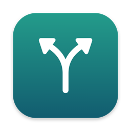

<p align="center"></p>

<h1 align="center">Lane</h1>

<p align="center">A tiny, free menu bar app that picks which browser opens your links.</p>

Lane sets itself up as your Mac's default browser. When you click a link, it sends the link to the browser you picked, or asks you each time.

- **Pick a browser from the menu bar.** Choose one browser for every link, or **Ask Every Time** to get a picker.
- **Keyboard-friendly picker.** It opens next to your pointer. Click a browser, or press 1–9. Return picks the first browser, esc cancels, and ⌘C copies the link.
- **Hold ⌥ Option** while clicking a link to get the picker, even when a browser is set.
- **Open at Login** keeps it in your menu bar after a restart.

No accounts, no tracking, no network access. It finds the browsers already on your Mac.

## Install

1. Download `Lane-<version>.dmg` from the [latest release](https://github.com/krittaprot/lane/releases/latest).
2. Open the DMG and drag **Lane** into **Applications**.
3. Open Lane. Because Lane isn't notarized by Apple yet, macOS blocks it the first time:
   click **Done**, open **System Settings → Privacy & Security**, scroll down, and click **Open Anyway** next to Lane.
4. Click the branch icon in the menu bar, then **Make Lane the Default Browser…**, and confirm.

Requires macOS 14 Sonoma or later. Runs on Apple Silicon and Intel Macs.

## Build from source

Requires Xcode 16 or later. From the project root:

```bash
scripts/install.sh
```

That builds `build/Lane.app`, copies it to `~/Applications`, and opens it. Other scripts:

- `scripts/build.sh`: build `build/Lane.app` only.
- `scripts/release.sh`: build `build/Lane-<version>.dmg` for distribution.

Settings are stored in `UserDefaults` under `com.krittaprot.lane`.

## Uninstall

Pick another default browser in **System Settings → Desktop & Dock → Default web browser**, quit Lane from its menu, and delete it from Applications.

## Credits

Inspired by browser pickers like [Velja](https://sindresorhus.com/velja). Lane is written from scratch and shares no code or artwork with them.

## License

[MIT](LICENSE)
